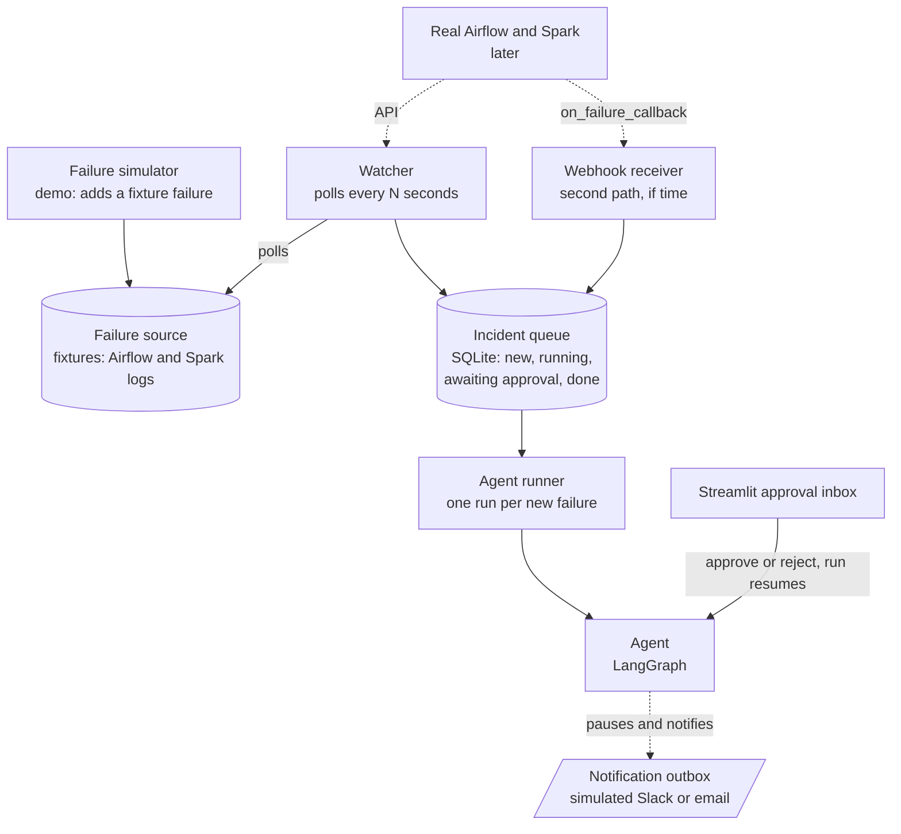
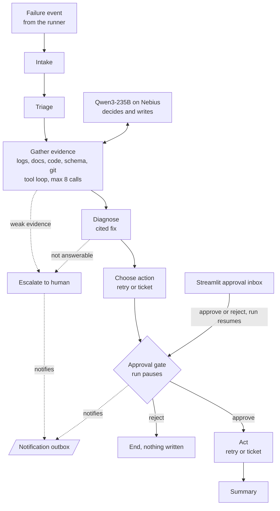
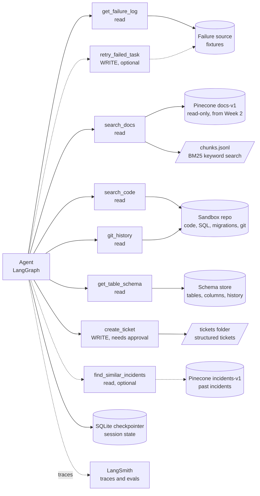
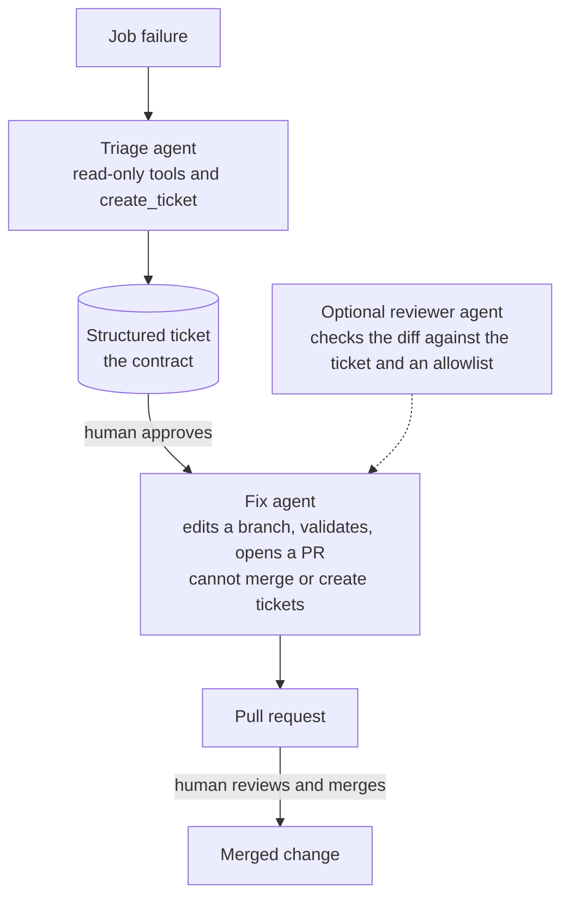

# Architecture: Pipeline failure-triage agent

An agent that starts **on its own when an Airflow DAG run or a Spark job fails**. It finds the failed run, reads its log and settings, checks the cause against the official docs and past incidents, and proposes a cited fix. It never writes anything without a human's approval, and it hands off to a human when the docs do not cover the failure.

It builds on the Week 2 docs assistant: the Week 2 hybrid search becomes one of the agent's tools. The docs explain what an error means; for a failure caused by something company-specific, the agent also reads the company's **code, database schemas and git history** (section 8).

Decisions so far: a **poller** detects failures first, an Airflow **webhook** is a second path if time allows; notification is a **simulated outbox plus an approval inbox page** (email if time allows); failures are **simulated** for now, and a real Airflow comes later.

---

## 1. System architecture

### 1a. Trigger layer: how a failure starts the agent

```
 FAILURE SOURCES                 TRIGGER LAYER                              HUMAN
 ---------------                 -------------                              -----
 Failure simulator --adds a--> Failure source (fixtures)
 (demo)              failure        ^
                                    | polls every N seconds
 Real Airflow and Spark ......> WATCHER ----------+
 (later)                                          |
 Airflow on_failure_callback -> WEBHOOK ----------+--> INCIDENT QUEUE --> AGENT RUNNER
 (second path, if time)                               (SQLite: new,        (one agent run per
                                                       running,             new failure)
                                                       awaiting approval,        |
                                                       done, escalated)          |
                                                                                 v
 Engineer <--notification-- NOTIFICATION OUTBOX <--- run pauses at the approval gate
     |                                                                           ^
     +--approve / edit / reject--> STREAMLIT APPROVAL INBOX --resumes the run----+
```

- **Watcher:** a polling loop over a failure source. It remembers which runs it has processed, so one failure starts exactly one agent run. It works for Spark and Airflow alike and is the safety net for the webhook.
- **Webhook receiver (second path):** a small FastAPI endpoint. Airflow's `on_failure_callback` (documented for a DAG or a task, called with a `context` mapping) posts the DAG id, run id and task key to it.
- **Incident queue:** a SQLite table, one row per failure, with a state: `new`, `running`, `awaiting_approval`, `done`, `escalated`, `failed`.
- **Agent runner:** takes the next `new` incident and runs the graph with a structured event (system, DAG or application id, run id, time).
- **Notification outbox and approval inbox:** when a run reaches the approval gate it saves its state, writes a notification (a simulated Slack message in an outbox folder), and appears in the Streamlit inbox. The engineer approves, edits or rejects there, and the run resumes from where it paused, even much later.

### 1b. Agent, tools, and stores

```
                    +------------------------------------+
  Agent runner ---> |  AGENT (LangGraph state machine)   |--traces--> LangSmith
                    |  state kept by SQLite checkpointer |
                    +----+-------------------+-----------+
                         | decides           | calls
                         v                   v
                  Chat model            TOOLS (6 core, read-only unless noted)
                  Qwen3-235B            get_failure_log    -> failure source (trimmed, redacted)
                  (Nebius)              search_docs        -> Pinecone docs-v1 + BM25   (Week 2)
                                        search_code        -> sandbox repo: code, SQL, migrations
                                        get_table_schema   -> schema store: current + history
                                        git_history        -> sandbox repo: log and diff
                                        create_ticket      -> WRITE, needs approval
                                        optional: retry_failed_task (WRITE, needs approval),
                                                  find_similar_incidents (past incidents)

  Stores:  failure source (fixtures) | Pinecone airflow-spark-rag (docs-v1 read-only,
           incidents-v1 optional memory) | chunks.jsonl (BM25) | sandbox repo and
           schema store (synthetic "enterprise") | tickets folder | SQLite checkpointer
```

Design points:
- The **failure source** sits behind a small interface. The simulator writes fixture failures into it now; later it can be replaced by the Airflow REST API (`/api/v2`) and the Spark history server (applications, then jobs and stages with `?status=failed`, per the Spark `monitoring.md`). A failed Spark application is found through its failed jobs or stages, because the applications filter only offers `completed` and `running`.
- The only **write** is `create_ticket`, simulated by writing a file, so nothing real can be changed. Saving an incident to memory happens only after a human approves.
- The **sandbox** is a small synthetic "enterprise": a local git repo of DAG, SQL, Spark and migration files with a real history, plus a schema store with every table's versions. The agent reads **schemas only, never table rows**.
- `docs-v1` is the Week 2 namespace and is **read-only** here. New memory goes in a separate namespace, `incidents-v1`, in the same index (dimension 384, same embedding model).

## 2. Workflow (the explicit steps)

```
A job fails (or the simulator adds a failure)
  |
  v
[Trigger]  the watcher sees a new failed run (or the webhook receives one)
  |        deduplicate on (system, run id) -> incident queue -> agent runner
  v
[Intake]  read the event: which system, which run, when  (asks for more only if the event is incomplete)
  |
  v
[Triage]  fetch the failed run, Airflow or Spark, failure type
  |
  v
[Gather evidence] <---------------------+   loop, max 8 tool calls
  | log, docs, code, schema, git history|   tool error: retry once, carry on, note it
  v                                     |
 enough evidence? --- no, need more ----+
  | yes (or step cap reached)
  v
 enough support?  (docs relevance >= threshold, or code and schema evidence, or a similar past incident)
  |-- no --> [Escalate to human] --> notification --> END   (hand-off note: what was found)
  | yes
  v
[Diagnose]  cause + evidence + cited fix  (answerable? citation check)
  |-- not answerable --> [Escalate] --> END
  v
[Choose action]  transient failure -> retry | configuration problem -> ticket with the exact change
  |
  v
[APPROVAL GATE]  run PAUSES, state saved, notification sent, incident = awaiting_approval
  |   the engineer decides in the inbox: approve / edit / reject
  |-- reject --> END   (nothing written)
  | approve  (run resumes)
  v
[Act]  retry_failed_task or create_ticket  (+ save the incident to memory, if built)
  |
  v
[Summary] --> END
```

### What triggers the agent

Nobody types an alert. The trigger is the failure itself:

| Trigger | How it works | Status |
|---|---|---|
| **Watcher (polling)** | Every N seconds it lists failed runs in the failure source and queues any it has not seen | **Build first** (works for Airflow, Spark, and the simulator) |
| **Webhook (push)** | Airflow's `on_failure_callback` posts the failed run to an endpoint | Second path, if time allows |
| **Failure simulator** | A script makes a fixture job "fail" at a moment you choose, by adding the failure and its log to the failure source | **Demo and evaluation** (no live Airflow or Spark exists yet) |
| Real Airflow and Spark | The same adapters, pointed at the real APIs | Later |
| Manual CLI run | A developer starts an agent run by hand | Debugging only |

Intake now receives a structured event, not free text. A complete event goes straight to the failed run; a thin one (only a DAG name) makes intake call the `list_failed_runs` helper to find the run.

### Failure behavior

| Situation | What the system does |
|---|---|
| A tool raises an error | Retry once, then continue without it and say so in the result |
| A search returns nothing useful | One reworded query, then escalate |
| The log is missing | Mark the incident and escalate with what is known |
| The step cap (8 tool calls) is reached | Escalate with what has been found |
| A log contains instructions ("ignore your rules") | Treated as data, ignored, and flagged |
| A log contains secrets | Redacted before the model sees it |
| The same failure is reported twice | Ignored (deduplicated on system and run id) |
| A burst of failures | A cap on concurrent agent runs; the rest wait as `new`; failures from one DAG are grouped |
| The agent run crashes | Incident marked `failed`, a notification says so, nothing is written, and it can be queued again |
| The watcher cannot reach the failure source | Log it, back off, keep polling; no incident is lost |

## 3. Diagrams (Mermaid)

The same architecture as three small Mermaid diagrams, so each is readable on a page. They render in the VS Code Markdown preview with the Mermaid extension, and on GitHub.

### 3a. Trigger layer: how a failure starts the agent



### 3b. Agent workflow: the explicit steps



### 3c. Tools and stores



## 4. Components and what they do

| Component | Role | New or reused |
|---|---|---|
| Failure simulator | A script that makes a fixture job fail at a chosen moment | New |
| Failure source (fixtures) | 10 in-scope and 2 out-of-scope incidents with logs and settings, labelled synthetic; behind an interface that real Airflow and Spark can replace later | New |
| Watcher | Polls the failure source and queues each new failed run once | New |
| Webhook receiver | Receives Airflow failure callbacks (second path, if time) | New, optional |
| Incident queue | SQLite table of incidents and their states | New |
| Agent runner | Starts one agent run per new incident, with a cap on concurrent runs | New |
| LangGraph graph | The explicit steps, the loop and its step cap, and the approval interrupt | New |
| SQLite checkpointer | Keeps the state of each incident, so a paused run can be resumed later | New |
| Chat model (Qwen3-235B, Nebius) | Decides the next action and writes the diagnosis | Reused (tool calling to be tested) |
| `search_docs` | The Week 2 hybrid search (dense plus BM25, rank fusion) over the Airflow and Spark docs | Reused (copied) |
| `find_similar_incidents` | The same kind of search over past approved incidents (`incidents-v1`) | New, optional |
| `get_failure_log` (and the intake helper `list_failed_runs`) | Read the failure source; the log is trimmed and secrets redacted | New |
| `search_code` | BM25 and exact search over the sandbox repository, chunked by function and SQL statement | New |
| `get_table_schema` | Current columns and types of a table, and its version history; schemas only, never rows | New |
| `git_history` | `git log` and `git diff` for a path or a date range, trimmed | New |
| `create_ticket` | A write: saves a structured ticket (section 6) with the exact change and the owner from `CODEOWNERS`; asks for approval first | New |
| `retry_failed_task` | A write: marks a failed run as retried in the failure source; asks for approval first | New |
| Notification outbox | Simulated Slack message written to a folder when a run needs a human (email if time allows) | New |
| Streamlit approval inbox | Lists incidents awaiting approval, shows the diagnosis and cited sources, and has Approve, Edit and Reject | Streamlit reused from Week 2; the page is new |
| LangSmith | Tracing each run and recording evaluations | New |
| Sandbox repository | A synthetic local git repo of DAG, SQL, Spark and migration files, rebuilt by a script and kept out of the Week 3 repository | New |
| Schema store | A JSON file (or SQLite) of tables, columns, types and every schema version | New |

## 5. Roles and responsibilities

**The agent is responsible for:** triage (which run, which system, what kind of failure); gathering evidence by choosing which tools to call; a diagnosis with every claim cited; choosing and drafting an action; saying "I can't tell" and escalating; and reporting honestly what it checked, what it could not, and which tools failed.

**The agent must not:** fix, restart or re-run anything without approval; change code or configuration in a real system; read table rows (schemas only); answer from outside its knowledge sources; decide on its own that a write is safe; touch production credentials.

| Decision | Who | Why |
|---|---|---|
| Which tool to call next, when the evidence is enough, the wording of the diagnosis, which action fits | **The AI model** | This is the judgment part |
| One failure starts one run, the step cap, concurrency limits, redacting secrets, trimming logs, the allowlist of change types | **Plain code** | Rules that must hold every time |
| Whether a write needs approval | **Plain code** (always yes) | The model cannot talk its way past it |
| Whether the docs cover the failure | **Plain code** (a score threshold) first, then the model | The Week 2 pattern |
| Approve, edit or reject an action | **A human** | Anything that changes something is a human's call |
| What to do with an escalated failure | **A human** | The agent only hands over what it found |

| Action | Autonomy |
|---|---|
| Read logs, settings, docs, past incidents | Autonomous |
| Reword and repeat a search | Autonomous, once |
| Draft a ticket | Autonomous (it is only text) |
| Create the ticket, retry a task | **Needs approval** |
| Save an incident to memory (optional) | **Needs approval** |
| Anything on a real system | **Not allowed** in this project |

## 6. Action policy and the ticket contract

The agent chooses the action by failure type. "Confidence" is not a number the model reports; it is made of signals the code can check (the best retrieval score, how many independent sources agree, whether the change type is on an allowlist, whether the change validates, and the size of the change). The signals go in the ticket and decide the *kind* of output; they never remove the human's approval.

| What the evidence points to | Proposed action (needs approval) |
|---|---|
| A transient failure (executor lost, a flaky connection, retries not yet exhausted) | `retry_failed_task` |
| A configuration problem the docs explain, or a code or schema mismatch found in the repository | `create_ticket` carrying the exact change: file, line, old and new code or value, and the owner from `CODEOWNERS` |
| Unclear, conflicting, or out of scope | Escalate: report what was found, no write |

The ticket is a structured record (a Pydantic model), so a second agent can later read fields instead of interpreting prose:

```
{
  "ticket_id": "...",  "incident_id": "...",  "system": "airflow | spark",
  "run": {"dag_or_app": "...", "run_id": "...", "task": "...", "failed_at": "..."},
  "root_cause": "one or two sentences",
  "evidence": [{"kind": "log | doc | code | schema | commit | incident", "ref": "...", "quote": "...",
                "citation": "docs path > heading, or repo path:line, or commit id"}],
  "proposed_action": {"type": "retry | code_change | config_change | escalate", "target": {"file": "...", "line": 0, "key": "..."},
                      "old_value": "...", "new_value": "...", "bounds": "allowed range"},
  "confidence_signals": {"best_doc_score": 0.0, "sources_agreeing": 0, "similar_past_incident": false,
                         "change_allowlisted": false, "validation": "passed | failed | not_run"},
  "constraints": ["never touch the main branch", "never act on a real system"],
  "status": "draft | approved | fix_in_progress | pr_opened | merged | rejected",
  "owner": "from CODEOWNERS",  "approved_by": null,  "created_at": "..."
}
```

## 7. Future: multi-agent

The ticket is the interface between two agents that never call each other and read from a shared queue. Each gets only the permissions it needs, and humans approve at two points: the ticket, and the pull request.



- **Built in Week 3:** the triage agent, the incident queue and ticket states, tools as standalone functions, and the structured ticket.
- **Later:** the fix agent, a sandbox repository and then a real GitHub pull request, and an optional reviewer agent.
- **Rule for the fix agent:** validate a ticket against its schema and an allowlist before acting. A log can carry a hidden instruction into a ticket, so ticket text is never trusted as an order.
- **Harder later:** ticket quality, limiting bounces between agents, evaluating the whole chain, cost and time.

## 8. Enterprise knowledge: code, schema, and change history

The docs explain what an error *means*. When the cause is company-specific, the fix is in the company's own code, schemas and history. Example: a column's type changes and a DAG that still assumes the old type fails. No document says that, so the agent joins three facts: the failing task, the schema change, and the code that depends on it.

```
DAG fails: "invalid input syntax for type integer: 'N/A'"   (loading orders.customer_zip)
   |
   v
get_failure_log      -> table orders, column customer_zip, the failing task
search_docs          -> what this error class means                          (Week 2 search)
get_table_schema     -> customer_zip is now VARCHAR(10); it was INTEGER, changed on <date>
git_history          -> migration 0042 changed the type, merged 2 days ago
search_code          -> the DAG task and the SQL line that still cast it to INTEGER
   |
   v
Diagnosis: the column type changed and orders_load still assumes INTEGER.
Ticket (needs approval): the exact file and line, the old and the new handling,
the owner from CODEOWNERS, and every piece of evidence cited.
```

| Source | How it is accessed | Method |
|---|---|---|
| Docs | The Week 2 hybrid search (`search_docs`) | RAG |
| Code (DAGs, SQL, Spark jobs) | `search_code`: BM25 and exact search over chunks cut by function or SQL statement, with the repo, path, language and the table and column names each chunk mentions | Exact search plus retrieval (identifiers like `customer_zip` need an exact match) |
| Database schema | `get_table_schema`: the current columns and types, and the history of versions | Direct lookup, schema only, never rows |
| Change history | `git_history`: `git log` and `git diff` of a path or since a date, trimmed | Direct lookup |
| Ownership | `CODEOWNERS`, to route the ticket | Lookup |
| Past incidents | `find_similar_incidents` (optional) | RAG |

Concerns to design for, and to state in the project document:
- **Read-only access** limited to the allowlisted repositories and schemas, with an audit log.
- **No table rows**: they can hold personal data.
- **Code and comments are untrusted text** and can carry a hidden instruction, like a log.
- **Code and schemas would be sent to the model provider** (Nebius here). Many companies cannot allow this without an approved or self-hosted model.
- **Freshness:** re-index code when it changes, or search the live checkout.

The demo uses a **synthetic sandbox** (a small repository with a real git history, rebuilt by a script, and a schema store) with three enterprise incidents:

| Incident | What the agent must find | Proposed action |
|---|---|---|
| A column's type changed from integer to text and the load step still casts it to integer | The type change in the schema history and the migration commit, and the DAG and SQL line that still assumes the old type | Ticket with the exact line and the new handling |
| A column was renamed and a query still uses the old name | The rename in the schema history and migration, and the query that still uses it | Ticket with the exact query change |
| A job fails with a permission error after a migration created a new table | The migration that created the table, and the missing grant | Ticket for the owning team |
